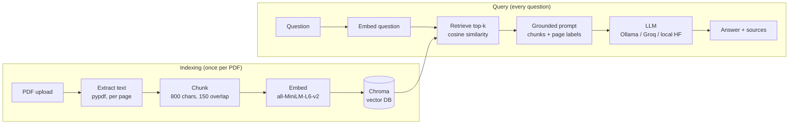

# 📄 ChatPDF: Chat with your PDF (free, local RAG)

Upload a PDF, ask questions in plain English, and get answers **grounded in the document with page citations**. It uses Retrieval-Augmented Generation (RAG) and runs **100% free**: no OpenAI key and no paid services. Embeddings, the vector database and (optionally) the LLM all run on your own machine.


[](https://github.com/KiranYuvan/ChatPDF/actions/workflows/ci.yml)


**🚀 Live demo: [kiranchatpdf.streamlit.app](https://kiranchatpdf.streamlit.app/)**. Hosted free on Streamlit Community Cloud and auto-deployed from the CI-gated `release` branch. Please upload only non-sensitive PDFs: the demo index is shared by all visitors and reset when the app restarts.

<!-- Add a screenshot: run the app, capture the chat view, save as docs/screenshot.png, then uncomment:

-->

---

## Why this project

LLMs don't know your private documents, and pasting a whole PDF into a prompt is slow, expensive and hard to verify. RAG retrieves **only the passages relevant to a question** and tells the model to answer **from those passages only**. The answer is then traceable to specific pages, and the model says so when the document doesn't contain the answer instead of making something up.

## Architecture



| Stage | Module | What it does |
|---|---|---|
| Ingest | [`app/pdf_loader.py`](app/pdf_loader.py) | Extracts text per page (keeps page numbers, rejects scanned PDFs that have no text) |
| Chunk | [`app/chunker.py`](app/chunker.py) | Recursive splitting at paragraph, then sentence, then word boundaries, with overlap; deterministic chunk IDs |
| Embed | [`app/embeddings.py`](app/embeddings.py) | Local sentence-transformers model producing normalized 384-dimensional vectors |
| Store / Retrieve | [`app/vector_store.py`](app/vector_store.py) | Persistent Chroma collection (cosine), idempotent re-indexing, per-document filter |
| Generate | [`app/llm.py`](app/llm.py) | One `LLMClient` interface with Ollama, Groq and Hugging Face implementations behind a factory |
| Orchestrate | [`app/rag.py`](app/rag.py) | `RAGService.index_pdf()` / `ask()`, with dependencies injected through the constructor |
| UI | [`ui/streamlit_app.py`](ui/streamlit_app.py) | Upload, index, pick a document, chat, and inspect the source chunks |

The core (`app/`) has no UI or web code, so the Streamlit UI and the planned FastAPI service are thin layers over the same `RAGService`.

## Example Q&A

Output from `python -m scripts.demo` on the bundled 5-page sample handbook, using the local `Qwen2.5-0.5B-Instruct` model on a laptop CPU (no GPU):

| Question | Answer | Top retrieved page (similarity) |
|---|---|---|
| How many days of paid annual leave do employees get, and how many can be carried over? | Employees receive **24 days** of paid annual leave per calendar year; up to **5 unused days** may be carried over. | p2 (0.70) |
| What is the hotel cap per night when travelling? | Hotel stays are capped at **220 US dollars per night** unless the city is on the high-cost list. | p4 (0.50) |
| How quickly must a lost laptop be reported? | **Within 24 hours.** | p5 (0.55) |
| What is the company's stock price? *(not in the PDF)* | *"I couldn't find that in the document."* | p3 (0.15): all scores low |

The last row matters most. When retrieval finds nothing relevant, the model says so instead of inventing an answer.

## Tech stack (all free)

| Concern | Choice |
|---|---|
| PDF parsing | `pypdf` |
| Chunking | `langchain-text-splitters` (just the splitter, not the full framework) |
| Embeddings | `sentence-transformers` + `all-MiniLM-L6-v2` (~90 MB, CPU) |
| Vector DB | `chromadb` (embedded, persisted to disk) |
| LLM | Ollama, Groq free tier, or a local Hugging Face model (see below) |
| Config | `pydantic-settings` (typed, validated, env-driven) |
| UI | Streamlit |
| Quality | `pytest`, `ruff` |

### Free LLM options

Selected with `CHATPDF_LLM_PROVIDER`. The default, `auto`, picks the best one available.

| Provider | Setup | Speed (CPU laptop) | Quality | Privacy |
|---|---|---|---|---|
| `ollama` | Install [Ollama](https://ollama.com), then `ollama pull llama3.2:3b` | ~5–15 tokens/s | Good | Fully offline |
| `groq` | Free API key from [console.groq.com](https://console.groq.com/keys), set `GROQ_API_KEY` | Very fast (hosted) | Best | Data sent to Groq |
| `huggingface` | Nothing; the model downloads on first use (~1 GB) | ~15–30 s per answer | OK for short factual Q&A | Fully offline |
| `auto` *(default)* | Uses Ollama if it's running, else Groq if a key is set, else Hugging Face | n/a | n/a | n/a |

## Try it without installing anything

[](https://codespaces.new/KiranYuvan/ChatPDF)

Click the badge to open a cloud workspace in your browser. Dependencies install automatically (allow ~5–10 minutes the first time). Then run `streamlit run streamlit_app.py` in its terminal, and port 8501 opens in a new tab. Every push is also linted and tested automatically by [GitHub Actions](https://github.com/KiranYuvan/ChatPDF/actions).

## Getting started

**Requirements:** Python 3.11 or 3.12 (torch and chromadb wheels lag behind newer versions). About 2 GB free disk space for packages and models. 8 GB RAM minimum, 16 GB recommended.

```bash
git clone https://github.com/<your-username>/<your-repo>.git
cd <your-repo>

python -m venv .venv
# Windows: .venv\Scripts\activate    macOS/Linux: source .venv/bin/activate

pip install -r requirements-dev.txt   # pinned runtime + dev dependencies
pip install -e .                      # makes the `app` package importable everywhere
cp .env.example .env                  # optional: tweak settings (Windows: copy)

python -m scripts.check_setup         # verify environment -> "=== ALL GOOD ==="
```

### Run the app

```bash
streamlit run streamlit_app.py     # http://localhost:8501
```

Upload a PDF in the sidebar, click **Index PDF**, and start asking questions. Expand **Sources** under an answer to see which chunks it was grounded on.

### Try it from the command line

```bash
python -m scripts.make_sample_pdf     # generates data/pdfs/sample_handbook.pdf
python -m scripts.demo                # indexes it and asks the 4 example questions
python -m scripts.demo path/to/your.pdf
```

### Run tests and lint

```bash
pytest                    # 31 tests: config, loader, chunker, vector store, RAG service, REST API
pytest -m "not integration"   # fast unit tests only (no embedding model)
ruff check . && ruff format --check .
```

The integration tests use the real embedding model and a temporary Chroma database. `RAGService` tests inject a fake LLM, so they're deterministic and need no model download for generation.

## REST API (FastAPI)

The same `RAGService` is also exposed as a REST API, so other apps (a React front end, a .NET service, Power Automate) can use it.

```bash
uvicorn api.main:app --reload      # interactive Swagger docs at http://localhost:8000/docs
```

| Method | Path | Purpose | Responses |
|---|---|---|---|
| `GET` | `/health` | Liveness probe (loads no models) | 200 |
| `POST` | `/documents` | Upload and index a PDF (multipart field `file`) | 201, 400 unreadable PDF, 413 too large |
| `GET` | `/documents` | List indexed documents | 200 |
| `DELETE` | `/documents/{name}` | Delete one document | 204, 404 |
| `POST` | `/ask` | `{"question": "...", "source": "optional.pdf"}` returns the answer plus source chunks | 200, 422 invalid body, 503 LLM unavailable |

Optional headers:
- `X-Namespace` keeps each tenant's documents separate.
- `X-API-Key` is required on every endpoint except `/health` when `CHATPDF_API_KEY` is set.

```bash
curl -F "file=@handbook.pdf" http://localhost:8000/documents
curl -H "Content-Type: application/json" -d '{"question":"What is the hotel cap?"}' http://localhost:8000/ask
```

## Docker

```bash
docker build -t chatpdf-api .
docker run -p 8000:8000 -e GROQ_API_KEY=$GROQ_API_KEY -v chatpdf-data:/data chatpdf-api
```

The image is CPU-only, runs as a non-root user, has a built-in `HEALTHCHECK`, and includes the embedding model so containers start without a download. The `chatpdf-data` volume keeps the Chroma index across container restarts. The same image can run the UI instead: append `streamlit run streamlit_app.py --server.port 8501 --server.address 0.0.0.0` and map port 8501.

## Configuration

All settings live in [`app/config.py`](app/config.py) and can be overridden with environment variables or a local `.env` file. See [`.env.example`](.env.example).

| Variable | Default | Purpose |
|---|---|---|
| `CHATPDF_CHUNK_SIZE` / `CHATPDF_CHUNK_OVERLAP` | 800 / 150 | Characters per chunk / shared between neighbours |
| `CHATPDF_EMBEDDING_MODEL` | `sentence-transformers/all-MiniLM-L6-v2` | Must stay the same between indexing and querying |
| `CHATPDF_TOP_K` | 4 | Chunks retrieved per question |
| `CHATPDF_LLM_PROVIDER` | `auto` | `auto`, `ollama`, `groq` or `huggingface` |
| `CHATPDF_MAX_UPLOAD_MB` | 20 | Upload limit, enforced on the server |
| `CHATPDF_LOG_LEVEL` | `INFO` | `DEBUG`, `INFO`, `WARNING` or `ERROR` |
| `GROQ_API_KEY` | none | Secret: environment variable or local `.env` only, never committed |

Secrets have no defaults, are typed as `SecretStr` (masked in logs), and `.env` is git-ignored.

## Design decisions

- **Chunk size of 800 characters (~200 tokens).** MiniLM truncates input past 256 tokens *silently*, so bigger chunks would lose content without any error.
- **150-character overlap.** A fact that straddles a chunk boundary still appears whole in one chunk.
- **Top-k of 4.** Enough context to contain the answer without drowning a small model in irrelevant text.
- **Deterministic chunk IDs plus delete-before-upsert.** Re-uploading a PDF replaces its chunks and never duplicates them.
- **Per-session namespaces.** Every query filters on a namespace (like a `TenantId` column), so visitors to the shared demo only see and search their own uploads.
- **Defensive input handling.** Size limit, file names stripped to their base name, and friendly errors for damaged, password-protected or scanned PDFs and for LLM outages (no raw tracebacks).
- **Thread-safe local model.** One shared in-process model answers one request at a time.
- **Temperature 0.1 and a strict system prompt.** Factual, repeatable answers, with an explicit "couldn't find that" response.
- **LLM behind an interface.** Switching provider is a configuration change, and tests use a fake.

## Project structure

```
app/            core RAG library (no UI code)
ui/             Streamlit front end
api/            FastAPI REST service (same RAGService)
scripts/        setup check, CLI demo, sample-PDF generator
tests/          pytest suite (unit + integration)
docs/           learning guide
data/           runtime PDFs + Chroma DB (git-ignored)
```

## Next steps (Step 8)

- [x] **FastAPI service:** `/documents`, `/ask`, `/health`, with optional API-key auth and namespaces, reusing `RAGService` unchanged
- [x] **Docker:** CPU-only image, non-root user, health check, embedding model included; built and smoke-tested in CI
- [ ] **Azure deployment:** Azure Container Apps (or App Service for Containers), with secrets in Key Vault surfaced as environment variables, and Chroma on an Azure Files volume
- [x] **CI/CD:** GitHub Actions runs `ruff`, `pytest` and a Docker build plus smoke test on every push and pull request, then promotes passing `main` commits to `release`, which Streamlit Cloud deploys. Dependabot proposes weekly dependency updates.
- [ ] Retrieval quality: hybrid BM25 + vector search, a reranker, and an evaluation set of question/answer pairs
- [ ] OCR fallback for scanned PDFs, and streaming responses in the UI
